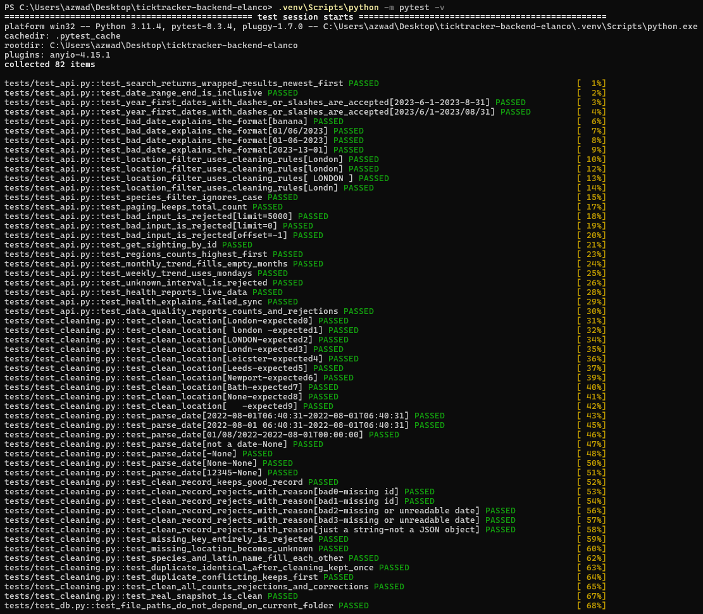
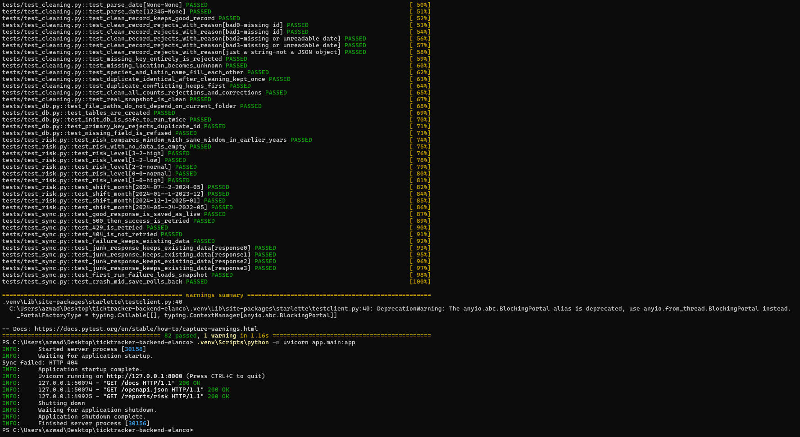
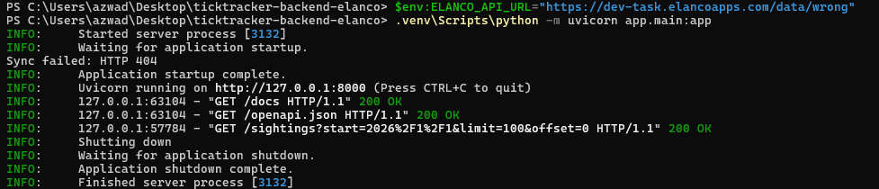

# Tick Tracker backend (Elanco placement task)

A backend for a UK tick-sighting tracker, written in Python with FastAPI and SQLite by Azwad Tahmid.

Walkthrough video: https://youtu.be/YfWWgTXJ4wg

## Features

- Fetches all sightings from the Elanco Tick Sightings API when the server starts, and retries on timeouts, rate limits (429) and server errors (5xx).
- Keeps serving the last good data if Elanco fails. On a first run with no data, it loads a saved snapshot instead.
- Cleans the data before storing it: removes duplicates, rejects records with no id or date, and fixes city names (spacing, capitals and close typos).
- Search and filter sightings by date range, city and species.
- Sightings per region (city).
- Trends per week or month.

It also has a seasonal risk report per city, a health check and a data-quality report. These are described under Endpoints.

## How it works

```
Elanco API → sync.py → cleaning.py → SQLite (db.py) → main.py → /docs
```

When the server starts, `sync.py` downloads the sightings, `cleaning.py` fixes or rejects each record, and the result is saved to SQLite in one transaction. The endpoints in `main.py` read from SQLite, not from Elanco, so they still work while Elanco is down.

## Run it

You need Python 3.10 or newer. Internet is optional (see "When Elanco fails").

1. Get the code.

   ```bash
   git clone https://github.com/azwadtahmid/ticktracker-backend-elanco
   cd ticktracker-backend-elanco
   ```

   Without git, click Code → Download ZIP on GitHub, unzip it and open a terminal in that folder.

2. Create a virtual environment and install the packages. You only do this once.

   Windows:
   ```powershell
   python -m venv .venv
   .venv\Scripts\python -m pip install -r requirements.txt
   ```

   Mac / Linux:
   ```bash
   python3 -m venv .venv
   .venv/bin/python -m pip install -r requirements.txt
   ```

3. Start the server.

   Windows: `.venv\Scripts\python -m uvicorn app.main:app`

   Mac / Linux: `.venv/bin/python -m uvicorn app.main:app`

4. Open http://127.0.0.1:8000/docs. Pick an endpoint, click Try it out, then Execute. Press Ctrl + C in the terminal to stop the server.

To run the tests (use `.venv/bin/python` on Mac / Linux):

```powershell
.venv\Scripts\python -m pytest -v
```

There are 82 tests. They use a fake Elanco, so they don't need the internet.





## Endpoints

| Endpoint | What it returns |
|---|---|
| `GET /sightings` | Sightings filtered by `start`, `end`, `location` and `species`, newest first. `limit` (1 to 1000, default 100) and `offset` page through the results. |
| `GET /sightings/{id}` | One sighting, or 404 if the id doesn't exist. |
| `GET /reports/regions` | The number of sightings per city, optionally within a date range. |
| `GET /reports/trends` | Counts per `week` or `month`, with the same filters as `/sightings`. Periods with no sightings show 0. |
| `GET /reports/risk` | For each city, whether the latest 3 months are busier or quieter than the same months in earlier years. |
| `GET /health` | Whether the data is live or from the snapshot, and whether the last sync worked. |
| `GET /data-quality` | What cleaning did on the last sync: records fetched, kept, duplicated, rejected (with the raw records and reasons) and typos corrected. |

Dates are year first, for example `2024-01-01` or `2024/1/1`. A date like `01/02/2024` is refused with a 422, because it could mean 1 February or 2 January.

List responses have the form `{"data_source": "live", "count": 12, "results": [...]}`. `count` is the total number of matches, not the size of the current page.

## Design choices

I store a copy of Elanco's data instead of calling Elanco on every request. That way the endpoints are fast and still work when Elanco is slow, rate limiting or down. The downside is that the copy can go out of date, so it re-syncs every time the server starts.

I used SQLite because the data survives a restart, SQL can do the filtering and counting, and there is nothing to install. The queries are raw SQL with `?` placeholders rather than an ORM. Most of them are counts and groupings, which are easier to read in plain SQL, and the placeholders prevent SQL injection.

Each sync deletes the old rows and inserts the new ones inside a single transaction, so the database matches Elanco, including any records Elanco removes. If the sync fails partway through, the transaction is rolled back and the previous data stays.

Requests to Elanco time out after 10 seconds. A timeout, connection error, 429 or 5xx is retried up to 3 attempts in total, waiting 1 second and then 2. Other errors, such as 404, are not retried. A response that isn't a JSON list, or that has no valid sightings, also counts as a failure.

### Cleaning rules

- A record with no id or no readable date is rejected. It is saved with the reason and shown in `/data-quality`.
- If an id appears twice, the first copy is kept.
- City names are matched against 14 known cities, ignoring case and extra spaces, so `" london "` becomes `London`.
- A misspelt city is corrected only if it is very close to a known one (`Londn` becomes `London`). A city that isn't on the list, such as `Bath`, is kept as it is.
- A missing city is stored as `Unknown`.
- A missing species is filled in from the Latin name, and the other way round.
- Dates are read in a few known formats. Dates with slashes are read day first, the UK way.

Elanco's data was clean when I checked it (no duplicates, missing fields or typos), so `/data-quality` shows zeros. The tests check each rule with made-up bad records.

### Risk report

For each city, the report compares the number of sightings in the latest 3 months with the average for the same 3 months in earlier years. A city is "high" at 1.5 times the usual number or more, and "low" at 0.5 times or less. `low_data` is true when the usual number is below 1, meaning there is too little history to rely on the result. I used 3 months because a single month had too few sightings per city to compare. The thresholds are my own choice, not based on veterinary guidance.

## When Elanco fails

- If the sync works, live data is served.
- If it fails and data is already stored, the stored data is kept.
- If it fails on the first run, `data/seed.json` is loaded. This is a copy of the 1,000 records taken on 30 October 2026.

`/health` says which of these happened. To try it, start the server with a broken URL:

```powershell
$env:ELANCO_API_URL="https://dev-task.elancoapps.com/data/wrong"
.venv\Scripts\python -m uvicorn app.main:app
```

On Mac / Linux:

```bash
ELANCO_API_URL=https://dev-task.elancoapps.com/data/wrong .venv/bin/python -m uvicorn app.main:app
```

The sync fails with a 404, but the server still starts and `/sightings` still returns data:



## Project structure

```
app/
  main.py        endpoints and reports
  sync.py        fetching from Elanco, retries, saving, fallback
  cleaning.py    cleaning rules
  db.py          SQLite tables
data/seed.json   snapshot loaded if the first sync fails
tests/           pytest tests
```

## Limitations and next steps

- The 14 known cities are a fixed list in `cleaning.py` (`KNOWN_CITIES`). New cities are stored, but typo correction only works for cities on the list, so it needs updating if Elanco adds more.
- Typo correction is a guess. It needs a similarity of at least 0.8, which stops real places like Newport being changed to Newcastle, but it could still get an unusual name wrong.
- A region is a city, because the data only has cities. Grouping cities by nation would be a simple addition.
- Data is only synced at startup. A real deployment would sync on a schedule.
- For much more data I would move to PostgreSQL and fetch only new or changed records.
- There is no frontend. Swagger at `/docs` is used to demonstrate the API, and a frontend could call the same endpoints once CORS is enabled.
- I didn't build the optional AI/ML extension. One option would be forecasting next month's sightings per city from the trend data.
- I have only tested it on Windows with Python 3.11.
